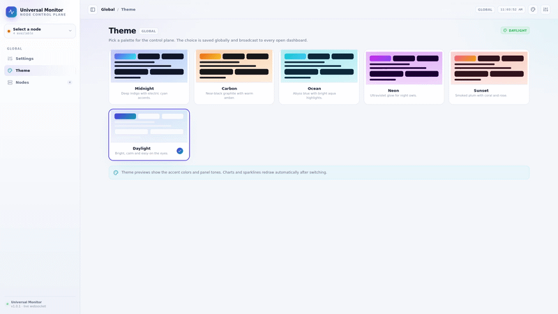
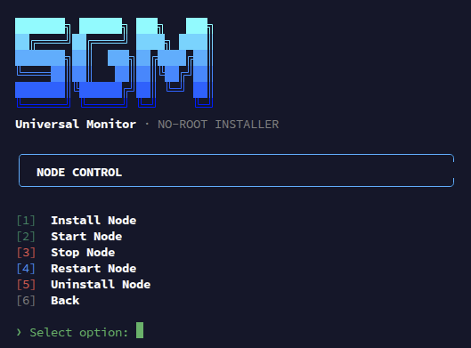
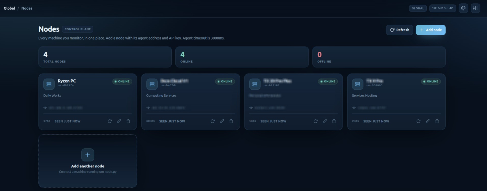
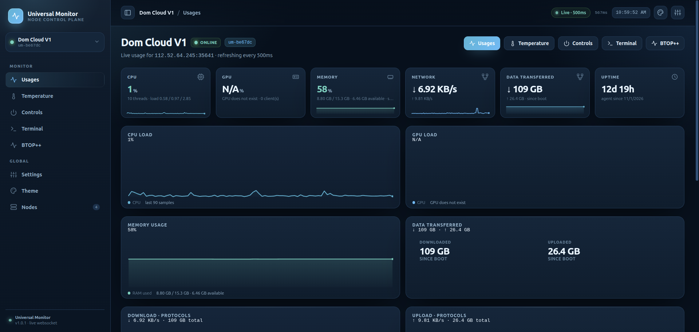
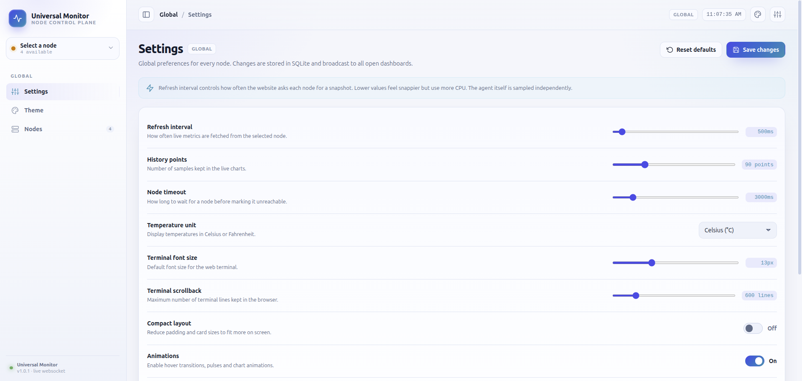

# Universal Monitor

<p align="center">
  
  
  
  
</p>

<p align="center">
  <strong>A modern control plane for Linux nodes.</strong><br>
  Live metrics, interactive terminals, BTOP++, power controls, node management, themes, and a beautiful web dashboard.
</p>

---

## Screenshots

<p align="center">
  
</p>

<p align="center">
  
  
</p>

<p align="center">
  
  
</p>


---

## Features

- Real-time CPU, memory, disk, network, GPU, and thermal metrics over WebSocket
- Interactive web terminal with persistent working directory
- BTOP++ process monitor in an interactive PTY
- Node management with stable IDs and API keys
- Machine detection for desktops, laptops, servers, VMs, containers, ARM devices, SBCs, and TV boxes
- GPU detection for Mali/Panfrost, NVIDIA, AMD/ATI, Intel, Qualcomm, Broadcom, and VideoCore
- Memory and disk views with used, total, and available capacity
- `GPU does not exist` fallback when no GPU is present
- All readable thermal sensors from `/sys/class/thermal` and `/sys/class/hwmon`
- Power capability detection for reboot and shutdown
- Cross-platform installer TUI with a detected machine panel
- Themes, settings, and node health checks
- Stable ports and API keys across restarts

---

## Installation

### Root installation

Run on a supported Linux VPS as root:

```bash
sudo bash -c 'tmp=$(mktemp /tmp/.sgm-installer.XXXXXX.sh); trap "rm -f \"$tmp\"" EXIT INT TERM; curl -fsSL https://github.com/ShahedPlayz/Universal-Monitor/raw/HEAD/install.sh | tr -d "\r" > "$tmp"; bash "$tmp"'
```

The root installer downloads the project, installs dependencies, creates a stable node config, and starts services with pm2. It includes a TUI for installing the node, installing the web control plane, and checking status.

### No-root installation

Use this when you do not have sudo access. It never uses `sudo`, `apt`, `dnf`, `yum`, `apk`, `brew`, or `pacman`, and installs everything under `~/.universal-monitor`:

```bash
bash -c 'tmp=$(mktemp /tmp/.sgm-nonroot.XXXXXX.sh); trap "rm -f \"$tmp\"" EXIT INT TERM; curl -fsSL https://github.com/ShahedPlayz/Universal-Monitor/raw/HEAD/install-nonroot.sh | tr -d "\r" > "$tmp"; bash "$tmp"'
```

The no-root installer creates a user Python virtual environment, installs web dependencies there, and manages node/web processes with PID files. It does not install `btop` automatically.

---

## Power controls

The agent reports whether reboot and shutdown are supported:

- Root agents on physical or virtual machines can reboot and shut down.
- Non-root agents report both actions as unsupported.
- Containers report both actions as unsupported.
- The website shows an animated success state when a rebooted node comes back online.
- The website shows an animated shutdown state until the node stops responding.
- Unsupported nodes show an animated unavailable state.

---

## Temperature monitoring

The agent scans:

- `/sys/class/thermal/thermal_zone*`
- `/sys/class/hwmon/hwmon*/temp*_input`
- `/sys/class/drm/card*/device/hwmon/hwmon*/temp*_input`

Every readable sensor is reported to the website and displayed live.

---

## License

This project is proprietary software owned by SGM. You may not modify, redistribute, sublicense, or reverse engineer it without explicit written permission. See `LICENSE`.
